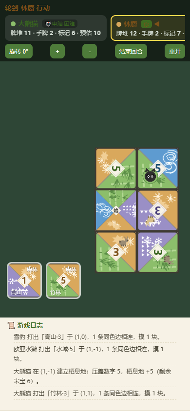

# 栖息地 · 大熊猫拼图对战 🐼

一款致敬桌游《栖息地》(Habitat) 的网页对战游戏：四位玩家（人类 / 电脑混合）在同一片熊猫家园
上铺设地形板块，修建栖息地、安放熊猫米宝、打通生态廊道，比拼谁能建成最完整的保护区。

**线上试玩：https://game.zhaozhiru.com**



## 玩法速览

- **铺设板块**：每回合从手牌选一块，贴着已有板块放置，边缘地形必须匹配。
- **栖息地**：同一地形连成的连通区，数字和达到 **10** 即触发——在该区任意板块的数字上
  安放一枚自己的熊猫米宝；压盖后区域面积减去该数字，仍 ≥10 可继续连压。
- **廊道**：同一连通区内有 **≥2 枚自己的米宝** 且区域 **闭合（无对外开口）**，即建成廊道。
- **每块板块最多 2 枚米宝，且四种地形各限 1 枚**；起始板块无数字，不可安放。
- **手牌 15 块**：数字 1–5 各 3 块；每个数字的三块恰好配齐其余三种地形各一次；
  数字 2、3 的板块带有动物图标。

## 计分

| 维度 | 规则 |
|---|---|
| 勘探 | 手牌中剩余数字各不相同的板块数量 |
| 栖息地 | 每个地形区中自己米宝压盖的数字之和 |
| 廊道 | 每条建成廊道的板块数 |
| 生物多样性 | 带动物板块相关奖励 |

## 人机对战

- 默认 4 名玩家，每位可自由切换 **人类 / 电脑**，动物（竹林 / 森林 / 高山 / 水域）任选。
- 电脑三档难度，且各自持有**固定行棋风格**，全程一致：
  - **困难（最佳策略）**：主动扩张自家栖息地制造更多触发机会，米宝优先压盖最大数字；
  - **中等**：稳健跟牌，压盖策略偏保守；
  - **简单**：随机性较高，适合新手练手。
- 桌面与移动端（触控拖动、双指缩放）均可流畅游玩。

## 本地运行

纯静态页面，无构建步骤：

```bash
# 任选一种静态服务器
npx serve web
# 或
python -m http.server 8080 --directory web
```

浏览器打开 http://localhost:8080 即可。

## 测试

```bash
cd web
node ../tests/area_tests.js    # 面积触发模型规则测试（24 项）
node ../tests/comp_tests.js    # 备选手牌和模型测试（18 项）
node ../tests/ai_test.js 20    # 三档 AI headless 对局模拟
node ../tests/mobile_test.js   # 移动端端到端测试（需 Playwright）
node ../tests/smoke.js         # 桌面端端到端冒烟测试（需 Playwright）
```

## 技术要点

- 零依赖原生 JS，Canvas 渲染，Pointer Events 统一鼠标 / 触控；
- 板块素材按实物照片重绘（`gen_assets.py` 生成，已随仓库附带成品）；
- 部署：Cloudflare Pages，`main` 分支 push 后自动发布。

## License

MIT
